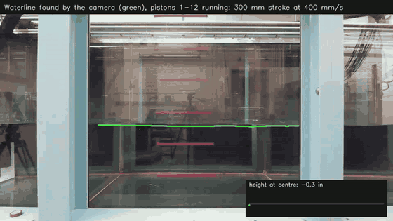

# Wavemaker System Control

Control software for the UNC Fluids Lab wavemaker: thirty LinMot pistons driven
by an Allen-Bradley ControlLogix PLC, in three rows of ten.

- **Operators** — read [docs/OPERATING.md](docs/OPERATING.md).
- **Developers** — read [docs/DEVELOPING.md](docs/DEVELOPING.md).
- **Driving it from a terminal or an agent** — read [wavectl/README.md](wavectl/README.md).



*The camera measurement (`vision/`) watching a run of pistons 1-12 through the
side wall: the waterline it detects is drawn in green, and the inset traces the
height at the middle of the window. Recorded 16 Nov 2026;
[full-quality MP4](docs/media/waterline-demo.mp4). How this footage is turned
into a model of the water is in [docs/VISION_HANDOFF.md](docs/VISION_HANDOFF.md).*

## Running it

Double-click **`Open Wavemaker.cmd`**. That is the whole procedure.

It does not open Studio 5000 and does not wait for a keypress. The application
opens its own EtherNet/IP session to the controller; Studio 5000 "Go Online"
connects *Studio 5000* to the controller, not this application.

The one real prerequisite is that the controller is in **Run**, because the
ladder logic has to be scanning. That is persistent state -- it stays in Run
until somebody changes it -- so it is not a per-launch step. If the application
cannot reach the controller it says so at the top of Control Home and offers
**Reconnect** and **Open Studio 5000** buttons.

## Trying it without the machine

Double-click **`Mock Wavemaker (no machine).cmd`**. It runs a simulated
wavemaker: no PLC is contacted and nothing physical can move, so it is safe on
any laptop, anywhere.

The mock is not an empty shell. Its pistons really stroke between Position 1 and
Position 2 at the speeds you set, homing takes a moment, and a Curve Offset
staggered front to back really does produce a wave that travels along the
chamber, which you can watch in the live view. Use it to learn the interface and
to build presets before going near the tank.

It does **not** predict how the real machine behaves. It moves rectangles.

From a terminal:

```
py -3 main.py                # normal use: connect to the PLC
py -3 main.py --mock         # the simulated wavemaker
py -3 main.py --ip 10.0.0.5  # a different PLC address
```

If the PLC does not answer, the application says so in the banner at the top of
Control Home and runs in simulation instead of failing to start. **Nothing moves
in simulation.**

## What you need

- Windows with Python 3.8 or newer (`py -3 --version` should print a version).
- `tkinter`, which comes with the standard Windows Python installer.
- Optional: `pip install -r requirements.txt` for MongoDB analytics storage.
  Without it, analytics are still written to `analytics/<date>.txt`.

The PLC library (pylogix 0.2.0) is vendored in `modules/`; there is nothing to
install for it.

## How the interface is laid out

| Tab | What it is for |
|---|---|
| **Operate** | Everything needed to run: choose pistons on the tank, set stroke and speed, press Start. Shows the pistons moving live while the machine runs. |
| **Wave** | Choose and send a repeating piston-motion pattern. Its Height is motor stroke, not measured water height. |
| **Soliton** | Set target crest height and width, stage the vertical floor, and fire one bounded upward trial pulse. Record observed dimensions; repeated matching hardware trials can suggest a floor lift. |
| **Preset Options** | Load saved parameters onto groups, or save the groups you have built. |
| **Feedback** | Everything the application has done. Also written to `logs/<date>.log`. |

### Groups

Selected pistons are simply "the pistons that will run" -- there is no step to
confirm them. If you need two lots of pistons running with different parameters
at the same time, press **Add group**; only then does the idea of a group appear
at all.

## A first run

1. **Click or drag on the tank** to choose pistons.
2. Set **stroke** and **speed**. Everything else is behind *All parameters*.
3. Press **Start**.

Start does whatever is needed: it writes any changed parameters, homes the
pistons if they are not homed, then runs. Homing physically moves every piston
and takes about a minute, so the first run asks before doing it. After that
Start is immediate.

**Stop** is always available, on every tab, and `Escape` does the same. After a
stop the pistons return to the bottom of their stroke; pressing Stop again while
they are moving there leaves them where they are.

## Folders

```
main.py               entry point (plus the three .cmd launchers for the lab PC)
Model.py              application state and every machine command
Motor.py              one piston: its parameters and drive state
View.py               the window; routes worker callbacks onto the Tk thread
app/                  paths, PLC tags, transport, parameters, patterns, solitons, the mock
operate/  wave/       the Operate and Wave/Soliton tabs
preset_options/       Preset Options tab and the preset file reader/writer
diagnostics/ feedback/  the remaining tabs
modules/              vendored pylogix, the tank drawing, drawn widgets, logging
Presets/              saved parameter files
wavectl/              command-line control of the array, one long-lived session
vision/               camera measurement of the water (needs NumPy/OpenCV)
tank-model/           approximate model of the tank, blueprints, photos (own .venv)
tools/
  live/               hardware experiments -- these MOVE REAL PISTONS
  camera/             camera rig, recording, fitting (never contact the PLC)
  analysis/           one-off fitting scripts
  make_presets.py     regenerates Presets/ from app/patterns.py
  make_usb_copy.ps1   builds the offline copy for the lab PC
tests/                test suite; runs with no hardware
docs/                 operating, developing, lab notes; findings/ and media/
logs/  analytics/     written at run time (not committed)
archive/              superseded code, documentation and 2022 logs
```

## Credits

- Adrian Hito
- William Keffer
- Alexander Caza
